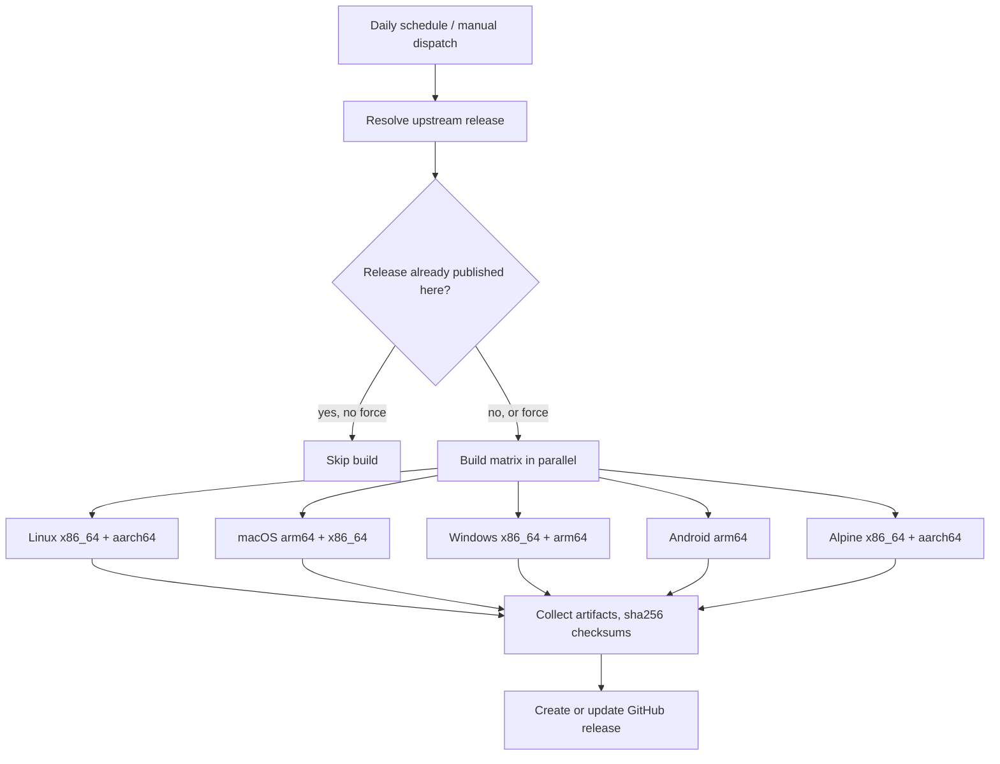

# aria2-next auto builds

Unmodified builds of [AnInsomniacy/aria2-next](https://github.com/AnInsomniacy/aria2-next) for
every platform upstream ships, plus statically linked musl builds for **Alpine Linux**.

This repository holds no source code. Each run checks out the upstream release tag into a
clean tree and builds it with upstream's own packaging scripts, so the binaries behave the
same as the official release.

## Release assets

Tags mirror upstream (`v3.1.1`). Every release carries:

```
aria2-next-<version>-linux-x86_64
aria2-next-<version>-linux-aarch64
aria2-next-<version>-macos-arm64
aria2-next-<version>-macos-x86_64
aria2-next-<version>-windows-x86_64.exe
aria2-next-<version>-windows-arm64.exe
aria2-next-<version>-android-arm64
aria2-next-<version>-alpine-x86_64
aria2-next-<version>-alpine-aarch64
aria2-next-<version>-checksums.sha256
```

Verify a download with `sha256sum -c aria2-next-<version>-checksums.sha256`.

## How a run works



1. **check** resolves the target tag — `releases/latest` by default, or `releases/tags/<tag>`
   when a version is supplied — and records `should_build` plus the tag's `published_at`
   timestamp.
2. **build jobs** run in parallel only when `should_build` is true. The native, Windows,
   and Android jobs check their runner with `packaging/scripts/verify-runner-tools
   <profile>` before calling `packaging/scripts/build-release <platform>`; Alpine builds
   run their own script inside a container instead.
3. **publish** downloads all artifacts, writes `aria2-next-<version>-checksums.sha256`,
   creates the release if it does not exist, and uploads the assets with `--clobber`.

Toolchain selection, size flags, and runtime verification come from upstream's scripts, so
they track the official release.

## Build matrix

| Target | Runner | Toolchain |
| --- | --- | --- |
| Linux x86_64 | `ubuntu-22.04` | native GCC (glibc 2.35 baseline) |
| Linux ARM64 | `ubuntu-22.04-arm` | native GCC |
| macOS ARM64 | `macos-15` | native Clang, `MACOSX_VERSION_MIN=11.0` |
| macOS Intel | `macos-15-intel` | native Clang, `MACOSX_VERSION_MIN=11.0` |
| Windows x86_64 | `ubuntu-24.04` | LLVM-MinGW (ucrt) |
| Windows ARM64 | `ubuntu-24.04` | LLVM-MinGW (ucrt) |
| Android ARM64 | `ubuntu-24.04` | Android NDK, API 24 |
| **Alpine x86_64** | `ubuntu-24.04` | `alpine:3.24` container |
| **Alpine aarch64** | `ubuntu-24.04-arm` | `alpine:3.24` container |

All builds use `ARIA2_BUILD_PROFILE=release` and `CMAKE_BUILD_TYPE=Release`, strip the
binary, and set `SOURCE_DATE_EPOCH` from the upstream release date so timestamps are
reproducible. Windows builds disable LTO (`ARIA2_RELEASE_LTO=OFF`); Alpine builds keep
it on and enable the size-optimised profile.

Job timeouts are 240 minutes for native/Windows/Android builds and 300 for Alpine.

## Alpine builds

`scripts/build-alpine.sh` runs upstream's release profile inside an Alpine container
(musl + GCC) and links statically via `ALPINE_LDFLAGS=-static`:

- `aria2-next-<version>-alpine-x86_64`
- `aria2-next-<version>-alpine-aarch64`

A static binary has no `libstdc++` dependency and no libc version floor, so it runs in any
Alpine image of the same architecture. Upstream's `check-runtime-deps linux` still runs
unchanged: a static musl binary has no `NEEDED` entries, no interpreter, and no `GLIBC_*`
symbols.

Two constraints come from the container:

- Alpine 3.24 ships CMake 4, which rejects vendored projects declaring an old policy
  minimum. The build exports `CMAKE_POLICY_VERSION_MINIMUM=3.5`, which CMake also applies
  to every `ExternalProject` sub-build.
- The script must run from the root of an upstream checkout (it sources
  `packaging/scripts/release-size-profile`), which is how the workflow invokes it.

## Pinned dependencies

Only the CI layer is pinned here; upstream's own vendored libraries (OpenSSL, curl, Boost,
libtorrent, FFmpeg, GPAC, …) follow `packaging/dependencies.env` in the upstream tag and
are never overridden.

| Dependency | Version |
| --- | --- |
| `actions/checkout` | `v7.0.1` |
| `actions/upload-artifact` | `v7.0.2` |
| `actions/download-artifact` | `v8.0.2` |
| Alpine base image | `alpine:3.24` |

`.github/dependabot.yml` opens weekly `github-actions` pull requests (max 5 open, `ci`
commit prefix); merging them is all the maintenance these pins need.

## Running manually

Actions → **Auto build aria2-next** → *Run workflow*:

- **version** — optional upstream tag (`v3.1.1` or `3.1.1`); empty means the latest release.
- **force** — rebuild even if this repository already has that release; assets are
  re-uploaded with `--clobber`.

The schedule runs daily at 03:00 UTC. Runs are serialised by a `concurrency` group so two
builds never publish the same tag at once.

## One-time setup

Settings → Actions → General → **Workflow permissions** → *Read and write permissions*.
The workflow declares `permissions: contents: write` and uses the default `GITHUB_TOKEN`
to create releases and upload assets — no extra secrets are required.

## Notes

- Binaries are GPLv2, matching upstream; sources and license material live in the upstream
  release tag.
- Linux builds stay on `ubuntu-22.04` to keep the glibc baseline at 2.35, like upstream.
  Moving to `ubuntu-24.04` would raise it to 2.39.
- If upstream adds or renames a target, update the matrix in `auto-build.yml`;
  `verify-runner-tools` fails loudly when a runner no longer matches its profile.
