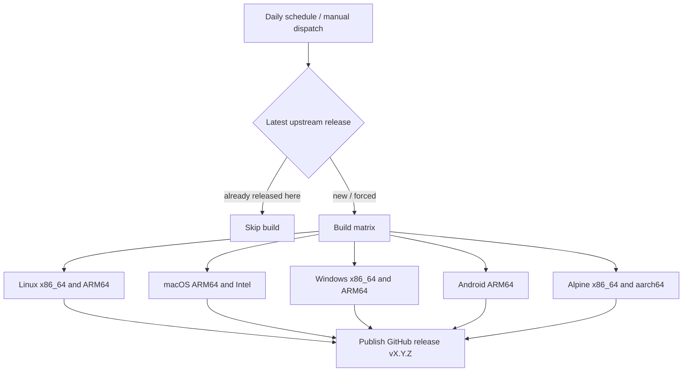

# auto-build-aria2-next

GitHub Actions for [AnInsomniacy/aria2-next](https://github.com/AnInsomniacy/aria2-next):
it watches upstream releases, rebuilds the binaries the same way upstream does, adds
builds for **Alpine Linux (static musl)**, and publishes them as a release here.

No source is stored in this repository. Every build checks out a clean tree of the
upstream release tag, so the binaries are unmodified upstream builds.

## Files

| Path | Purpose |
| --- | --- |
| `.github/workflows/auto-build.yml` | Watch upstream, build matrix, publish release |
| `.github/dependabot.yml` | Weekly updates for the workflow dependencies |
| `scripts/build-alpine.sh` | Static musl build inside an Alpine container |

## How it works



`check` asks `GET /repos/AnInsomniacy/aria2-next/releases/latest`. If a release with
that tag already exists here the build jobs are skipped; otherwise the whole matrix
runs. Pass `force: true` to rebuild and re-upload the assets.

Builds drive upstream's own packaging scripts (`packaging/scripts/build-release`,
`verify-runner-tools`, `check-runtime-deps`), so toolchain choices, size flags, and
runtime verification stay identical to the official release.

## Build matrix

| Target | Runner | How |
| --- | --- | --- |
| Linux x86_64 | `ubuntu-22.04` | native build (glibc 2.35 baseline) |
| Linux ARM64 | `ubuntu-22.04-arm` | native build |
| macOS ARM64 | `macos-15` | native build |
| macOS Intel | `macos-15-intel` | native build |
| Windows x86_64 | `ubuntu-24.04` | LLVM-MinGW |
| Windows ARM64 | `ubuntu-24.04` | LLVM-MinGW |
| Android ARM64 | `ubuntu-24.04` | Android NDK |
| **Alpine x86_64** | `ubuntu-24.04` | `alpine:3.24` container |
| **Alpine aarch64** | `ubuntu-24.04-arm` | `alpine:3.24` container |

### Alpine builds

`scripts/build-alpine.sh` runs upstream's superbuild inside an Alpine container
(musl + GCC) and links the result **statically**:

- `aria2-next-<version>-alpine-x86_64`
- `aria2-next-<version>-alpine-aarch64`

A static binary needs no `libstdc++` and no particular libc version, so it drops into
any Alpine image on the same architecture. Upstream's `check-runtime-deps linux` still
runs: a static musl binary has no `NEEDED` entries, no interpreter, and no `GLIBC_*`
symbols, so it passes unchanged.

Alpine 3.24 ships CMake 4, which rejects projects declaring an older policy minimum.
The vendored trees are upstream code, so the build sets
`CMAKE_POLICY_VERSION_MINIMUM=3.5` — CMake reads it from the environment, which also
covers every `ExternalProject` sub-build.

## Workflow dependencies

Everything this repository itself depends on is pinned to a current release:

| Dependency | Version |
| --- | --- |
| `actions/checkout` | `v7.0.1` |
| `actions/upload-artifact` | `v7.0.2` |
| `actions/download-artifact` | `v8.0.2` |
| Alpine base image | `alpine:3.24` (current stable, 3.24.4) |

`.github/dependabot.yml` asks Dependabot for `github-actions` updates every week, so
these pins keep moving without manual work. Merging its PRs is all that is needed.

aria2-next's own libraries (OpenSSL, curl, Boost, libtorrent, FFmpeg, GPAC, …) are
**not** managed here: they follow whatever upstream vendors and pins in
`packaging/dependencies.env`, because upstream patches those trees and its CMake only
looks inside the bundled prefix. The builds therefore always match the upstream
release they are made from.

## Manual runs

Actions → **Auto build aria2-next** → *Run workflow*:

- **version** (optional): upstream tag such as `v3.1.1` or `3.1.1`; empty means latest.
- **force**: rebuild even if the release already exists (assets are re-uploaded with
  `--clobber`).

The schedule runs daily at 03:00 UTC.

## One-time setup

Repository → **Settings → Actions → General → Workflow permissions** → select
**Read and write permissions**. The workflow needs it to create releases and upload
assets; the default `GITHUB_TOKEN` is enough, no extra secret is required.

## Release assets

Release tags follow upstream (`v3.1.1`). Each release carries:

```
aria2-next-<version>-linux-x86_64
aria2-next-<version>-linux-aarch64
aria2-next-<version>-macos-arm64
aria2-next-<version>-macos-x86_64
aria2-next-<version>-windows-x86_64.exe
aria2-next-<version>-windows-arm64.exe
aria2-next-<version>-android-arm64
aria2-next-<version>-alpine-x86_64
aria2-next-<version>-alpine-aarch64
aria2-next-<version>-checksums.sha256
```

## Notes

- Binaries are distributed under GPLv2, matching upstream; sources and license
  material live in the upstream release tag.
- Linux builds use `ubuntu-22.04` / `ubuntu-22.04-arm` like upstream so the glibc
  baseline stays at 2.35. Moving to `ubuntu-24.04` would raise it to 2.39.
- If upstream adds or renames a build target, update the matrix in
  `auto-build.yml`; `packaging/scripts/verify-runner-tools` will fail loudly if the
  runner profile no longer matches.
